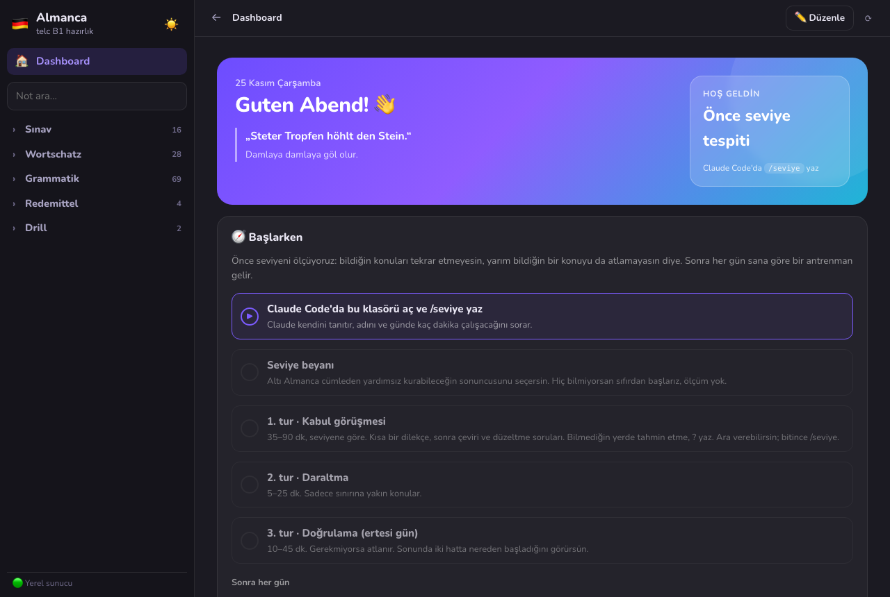

# 🇩🇪 Personal German Tutor

**Claude ile çalışan, sana göre ayarlanan kişisel Almanca öğretmeni.** Türkçe konuşanlar için, hedef **telc Deutsch B1**.

Önce seviyeni ölçer, sonra her gün tam o seviyeden bir antrenman hazırlar. Cevaplarını puanlar, hatanı türüyle açıklar ve neyi bildiğini, neyi yarım bildiğini takip eder. Bildiğin konuyu tekrar ettirmez, yarım bildiğin konuyu da atlamaz.

## Ne var içinde?
- **Seviye tespiti:** önce kısa bir soru (hangi cümleyi kurabiliyorsun?), sonra o seviyeye göre uyarlanan iki-üç tur. Sonunda iki hatta (fiiller ve cümle yapısı · isimler ve hâller) nereden başladığını ve aradaki boşlukları görürsün. Hiç bilmiyorsan ölçüm yok, sıfırdan başlarsın.
- **Günlük antrenman** (~30–60 dk, sen seçersin): gramer, kelime, Lesen, Hören, Schreiben ve telc'in soru biçimleri (Sprachbausteine, ilan panosu, e-posta) küçük ölçekte, A1'den itibaren.
- **Puanlama ve hata takibi:** her yanlışa kısa Türkçe açıklama ve doğru örnek. Aynı hata türü tekrar ederse sana özel bir mini drill açılır.
- **Kademeli müfredat:** A1'den B1'e ~70 gramer konusu, iki hatta sırayla. Her konu beş kademeden geçer (tanıma → üretme → cümle → serbest → bağlam).
- **Kelime ve cümle kartları:** en sık kullanılan 600 kelimeyle başlar, aralıklı tekrar, kaydırarak çalışma.
- **Tıklanabilir sözlük:** sayfadaki her Almanca kelimeye tıkla, Türkçesi ve kökü çıkar; 🗣 ile cümleyi dinle.
- **Tempelhof:** her gün bir karakterin günlüğü. Berlin'de, eski bir havalimanında geçen karanlık bir hikâye; senin seviyende yazılır, okursun, dinlersin, kağıda geçirirsin.
- **Dashboard:** serin, haftan, hataların, müfredattaki yerin, sınava kalan gün.

## Gerekenler
- **Claude hesabı** (Pro ya da üstü) ve **Claude masaüstü uygulaması** ([claude.ai/download](https://claude.ai/download)). Öğretmen Claude Code'un içinde çalışır.
- **Google Chrome** ya da **Microsoft Edge** (alıştırmaları tarayıcıda çözersin). Safari/Firefox da olur, aşağıya bak.
- **Mac önerilir.** Sesli dinleme dosyaları macOS'in Almanca sesleriyle üretilir. Windows ve Linux'ta deneysel: her şey çalışmalı, ama dinleme metinleri yazılı gelir.

## Kurulum (5 dakika)
1. **İndir:** bu sayfada yeşil **Code** düğmesi → **Download ZIP**. Zip'i aç, çıkan klasörü **Belgeler**'e taşı (adını değiştirebilirsin).
2. **Claude'u aç:** Claude masaüstü uygulamasında **Code** sekmesi → klasör olarak bu klasörü seç. Herhangi bir şey yaz, örneğin **"merhaba"**. Öğretmen kendini tanıtır ve seviye tespitine başlar. (macOS "geliştirici araçlarını yükle" derse **Yükle** de; Python bununla gelir.)
3. **Arayüzü aç:** klasördeki **`Almanca.html`** → sağ tık → **Birlikte Aç → Google Chrome** (ya da Edge) → **📁 Klasörü seç** → bu klasör → **Düzenlemeye izin ver**. Yer imlerine ekle; sonraki açılışlarda tek tık.
   - Safari ya da Firefox: **`Almanca.command`**'a çift tıkla (küçük bir Terminal penceresi açılır, açık kaldıkça çalışır). İlk seferde macOS izin isterse: sağ tık → Aç.

> **Daha doğal ses için (önerilir):** Sistem Ayarları → Erişilebilirlik → Konuşulan İçerik → Sistem sesi → Sesleri Yönet… → Almanca → *Anna (Premium)*, *Petra (Premium)*, *Markus*, *Yannick*.

## İlk gün: seviye tespiti
Claude adını, günde kaç dakika çalışacağını ve sınav tarihini sorar, sonra altı Almanca cümle gösterir: **sözlüksüz ve hatasız kurabileceğin son cümleyi** seçersin. Ölçüm buna göre kurulur.

| Tur | Süre | Ne var |
|---|---|---|
| 1 · Kabul görüşmesi | 35–90 dk (seviyene göre) | kısa bir dilekçe, sonra çeviri ve düzeltme soruları |
| 2 · Daraltma | 5–25 dk | sadece sınırına yakın konular |
| 3 · Doğrulama (ertesi gün) | 10–45 dk | gerekmiyorsa atlanır |

Bilmediğin yerde tahmin etme, `?` yaz: amaç puan değil, doğru başlangıç noktası. Ara verebilirsin, cevapların kaydedilir. Her turu bitirince Claude'a **`/seviye`** yaz.

## Her gün
| Ne zaman | Claude'a yaz | Sonra |
|---|---|---|
| Güne başlarken | **`/antrenman`** | tarayıcıda *Bugünün antrenmanı*'nı çöz |
| Bitince | **`/kontrol`** | puanlar, hatalarını açıklar, ilerlemeni günceller |
| Haftada bir | **`/analiz`** | haftalık gelişim raporu |
| Ara sıra | **`güncelle`** | yeni sürümü alır, ilerlemene dokunmaz |

Kısa bir günün varsa "bugün kısa antrenman" de (~15 dk). Kartlara antrenman olmayan günlerde de **Kartlar** sayfasından bakabilirsin.

## Verilerin
Her şey **kendi bilgisayarında**, bu klasörde durur: ilerlemen `_kisisel/` klasöründe, antrenmanların, hataların, günlüklerin ve analizlerin `05`–`10` numaralı klasörlerde. Yedek almak için bu klasörleri kopyalaman yeter. Claude'la konuştuğunda içerik, Claude hesabının koşullarıyla Anthropic'e gider; başka bir yere gönderilmez.

Klasör iki katmandır: **motor** (kurallar, müfredat, ekranlar, ders notları; herkes için aynı, güncellemeyle yenilenir) ve **kişisel** katman (senin verin; güncelleme dokunmaz).

## Sorun olursa
- **Arayüz "bu tarayıcı klasöre yazamıyor" diyor:** `Almanca.html`'yi Chrome/Edge ile aç ya da `Almanca.command`'ı kullan.
- **Claude'un hazırladığı not görünmüyor:** tarayıcı sekmesine dön; sayfa kendiliğinden tazelenir. Olmazsa sağ üstteki ⟳.
- **Ses yok ya da çok robotik:** yukarıdaki Almanca sesleri indir, sonra Claude'a "bugünkü sesleri yeniden üret" de.
- **Claude kuralları bilmiyor gibi davranıyor:** Claude Code'da açık klasör bu klasör olmalı (içinde `CLAUDE.md` olan).

## Spoiler uyarısı
`_sistem/Tempelhof/Sezon 1.md` hikâyenin bütün sürprizlerini içerir. Açma. 🙂

## Lisans
Kişisel ve eğitim amaçlı kullanım serbest; **ticari kullanım yasak**. Kod [PolyForm Noncommercial 1.0.0](LICENSES/PolyForm-Noncommercial-1.0.0.md), içerik [CC BY-NC-SA 4.0](LICENSES/CC-BY-NC-SA-4.0.txt). Ayrıntı: [LICENSE.md](LICENSE.md). telc ya da başka bir yayınevinin sınav materyalini içermez; resmi deneme sınavını kendin indirirsin ([01 Sınav/Deneme sınavı.md](<01 Sınav/Deneme sınavı.md>)).

---
*Bu proje Anthropic ya da telc ile bağlantılı değildir.*
